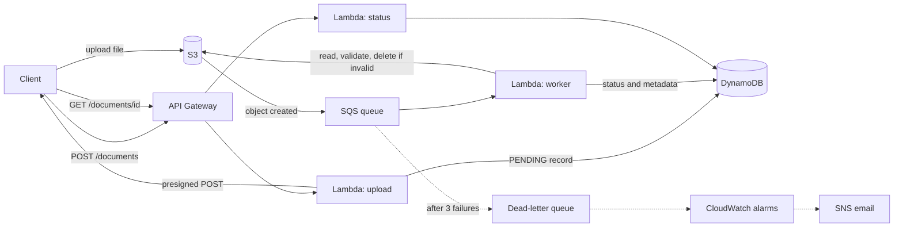
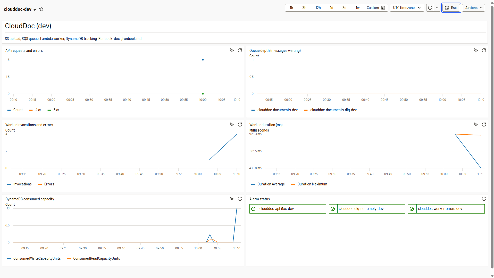
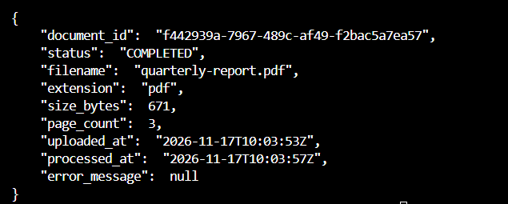

# CloudDoc: Serverless Document Processing on AWS

[](https://github.com/Red8-tech/CloudDoc/actions/workflows/ci.yml)


Clients upload PDF and TXT documents through an API. The system stores them
securely, validates them, extracts metadata, and tracks each document's status,
using only serverless AWS services.

## Problem

Organizations receive hundreds of documents a day. Uploading, validating,
organizing, and tracking them by hand is slow and error-prone. CloudDoc
automates the whole intake pipeline.

## Architecture



1. `POST /documents` validates the request, creates a `PENDING` record, and returns a presigned S3 upload form.
2. The client uploads straight to S3, which enforces the content type and the 10 MB limit.
3. S3 sends an event to SQS. The worker validates the real file contents, extracts metadata, and moves the record to `COMPLETED` or `FAILED`.
4. `GET /documents/{id}` returns the status and metadata.
5. A message that fails three times lands in a dead-letter queue and raises an alarm.

## Screenshots




## Tech stack

Python 3.12, API Gateway (HTTP API), Lambda, S3, SQS, DynamoDB, CloudWatch, SNS, IAM,
AWS SAM, Pytest, moto, GitHub Actions.

## Design decisions

| Decision | Why |
|---|---|
| Presigned POST, not PUT | S3 itself enforces the size range and content type, and file bytes never pass through the API |
| S3 to SQS to Lambda | The queue absorbs bursts, enables retries, and isolates failures in a dead-letter queue |
| Validate twice | The API checks the claim; the worker checks the real bytes, because clients can lie |
| Conditional DynamoDB writes | SQS delivers at least once, so every status change succeeds only from the expected state |
| Delete files only on permanent failure | Transient errors are retried and must never destroy the file |
| Least-privilege IAM per function | Each function gets only the S3 and DynamoDB actions it uses |

Full reasoning is in [docs/decisions](docs/decisions/).

## API

```bash
curl -X POST "$API/documents" -H "Content-Type: application/json" \
  -d '{"filename":"report.pdf","content_type":"application/pdf","size_bytes":2048}'
```

The response contains a `document_id` and an upload form. After uploading the file,
check its status:

```bash
curl "$API/documents/<document_id>"
```

```json
{
  "document_id": "adf56ffb-264a-4a52-9df0-25ee01d7c75e",
  "status": "COMPLETED",
  "filename": "two-pages.pdf",
  "extension": "pdf",
  "size_bytes": 551,
  "page_count": 2,
  "uploaded_at": "2026-11-15T10:20:16Z",
  "processed_at": "2026-11-15T10:20:20Z",
  "error_message": null
}
```

Every error uses one shape: `{"error": {"code": "...", "message": "..."}}`.
See the [API contract](docs/api-contract.md).

## Testing

- 115 automated tests with about 98% coverage, using moto so nothing touches a real account
- Failure paths are tested: duplicate deliveries, races between workers, transient S3 errors, malformed messages
- CI runs the tests, Ruff, and cfn-lint on every push, with no AWS credentials
- A load test (`scripts/load_test.py`) pushed 25 documents (20 valid, 5 deliberately invalid) through the live API.
  All ended in the correct state, with a median of 2 seconds (max 4) from API request to
  processed. A burst of simultaneous requests showed the API throttle rejecting excess calls
  with HTTP 429.

## Security and operations

- Private encrypted S3 bucket, HTTPS only, no public access
- 5-minute upload URLs, API throttling (5 requests/second per route), and worker concurrency capped at 2
- JSON logs kept 14 days, a CloudWatch dashboard, and alarms on the dead-letter queue, worker errors, and API 5xx
- Details in [docs/security.md](docs/security.md) and [docs/runbook.md](docs/runbook.md)

## Cost

The whole project, including development and load tests, used about US$0.00 of
the US$100 free-plan credit. Idle, the system costs nothing.

## Run it yourself

Requirements: Python 3.12, AWS CLI, AWS SAM CLI, an AWS account.

```bash
python -m venv venv && source venv/bin/activate     # Windows: .\venv\Scripts\Activate.ps1
pip install -r requirements-dev.txt
pytest

sam build -t infrastructure/template.yaml
sam deploy --guided
```

Tear everything down with `python scripts/teardown.py --include-sam-bucket`.

## What I would improve

- Authentication on the API (API key, Cognito, or a Lambda authorizer); today it is public and only throttled
- Automatic redrive and marking of documents that exhaust their retries
- DOCX support, duplicate detection by content hash, and search by status through a DynamoDB index
- Malware scanning of uploads and a WAF in front of the API
- Deployment from CI with GitHub's OIDC role instead of manual deploys

## Project structure

```
src/api/         upload and status Lambda handlers
src/processor/   SQS worker and metadata extraction
src/services/    S3 and DynamoDB wrappers
src/utils/       validators, config, responses, clock
tests/           unit and failure-path tests
infrastructure/  AWS SAM template
scripts/         live upload check, load test, teardown
docs/            requirements, API contract, data model, security, runbook, decisions
```

## Author

Arpan Mukherjee ([@Red8-tech](https://github.com/Red8-tech))